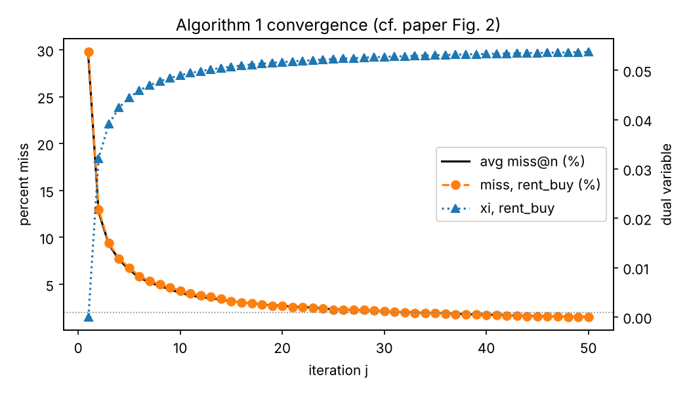

# Whole-page optimization with global constraints, rebuilt from scratch

A hands-on replication of

> Ding, Govindaraj & Vishwanathan. **Whole Page Optimization with Global Constraints.**
> KDD 2019. [doi:10.1145/3292500.3330675](https://doi.org/10.1145/3292500.3330675)

and the matching Amazon patent **US 10,915,336 B1**: how to compose a
personalized streaming homepage (a stack of carousels) that maximizes
engagement and diversity **while meeting business targets that only need to
hold on average across all users**.

You implement the method yourself, guided by a long, section-by-section
teaching document, and then reproduce the paper's experiments on a simulator
with known ground truth, and optionally on real catalog and impression data.



## Start here

1. Read [`docs/GUIDE.md`](docs/GUIDE.md) §0. It explains the workflow and maps
   every paper section to a guide section, a function to write, and a test.
2. Set up:
   ```bash
   python -m venv .venv && source .venv/bin/activate
   pip install -r requirements.txt
   WPO_IMPL=solutions pytest -q     # reference implementation: all pass
   pytest -q                        # your implementation: fails until you do the exercises
   ```
3. Work through the guide. Each exercise is a function in `src/wpo/` that
   raises `NotImplementedError("TODO: ...")`.
4. When everything passes, reproduce the paper:
   ```bash
   python experiments/run_all.py            # your code -> results/
   ```
   and compare with [`results/reference/`](results/reference).

## The eight exercises

| # | Function | Paper | Guide |
|---|---|---|---|
| 1 | `features.diversity_gain` | Eq. (3) | §3.3 |
| 2 | `features.diversity_features` | Eq. (3) | §3.4 |
| 3 | `model.BayesianLinearModel.fit` | Eq. (4) | §3.5 |
| 4 | `primal_dual.dual_update` | Alg. 1, line 6 | §5.4 |
| 5 | `primal_dual.solve_duals` | Alg. 1 | §5.5 |
| 6 | `greedy.compose_pages` | Alg. 2, Eq. (9) | §6.2 |
| 7 | `metrics.div_pair` | §5 metrics | §7.2 |
| 8 | `metrics.miss_at_n` | Eq. (10) | §7.2 |

## What gets reproduced (reference run, seed 0)

| Paper claim | Paper | This repo (simulated) |
|---|---|---|
| Global constraints cost little page value (Table 2) | −1.31% | −1.15% (model), −1.84% (true) |
| Slotting costs a lot (Table 2) | −25.6% | −6.90% (model), −7.20% (true) |
| Global constraints nearly meet targets (Table 2) | 1.5% miss | 4.5% miss (weekend transitions) |
| Never-buyers see far fewer rentals (Table 3) | −15.2% vs target | −62.7% vs target |
| Alg. 1 converges (Fig. 2) | ~30 iterations | 34 iterations to 2% miss |
| Yesterday's duals degrade at weekend transitions (Fig. 3) | yes | yes |

Full tables, figures, and an honest account of what differs and why:
[`docs/GUIDE.md` §7](docs/GUIDE.md#7-offline-experiments-paper-section-5).

## Data

Three sources, described in [`docs/DATASETS.md`](docs/DATASETS.md):

1. **Built-in simulator**: ground truth for every page; the core testbed.
2. **MovieLens + TMDB watch providers**: real catalog, tastes, and
   stream/rent/buy availability; simulated clicks.
   `python experiments/run_all.py --world movielens --providers data/providers.json`
3. **ContentWise Impressions** (CIKM 2020): real carousel impressions from a
   streaming service, used to calibrate the simulator.

## Demo app

```bash
pip install streamlit
streamlit run app/app.py                 # reference
WPO_IMPL=src streamlit run app/app.py    # your code
```

Pick a user who never rents and compare what slotting and global constraints
show them, plus today's category balance and dual prices.

## Layout

```
docs/GUIDE.md           the teaching document (start here)
docs/DATASETS.md        datasets, licenses, schemas, mapping to the paper
docs/REFERENCES.md      the paper's bibliography + outside reading, with where each is used
src/wpo/                YOUR implementation (exercises raise NotImplementedError)
solutions/wpo/          reference implementation (peek when stuck)
tests/                  pytest suite; WPO_IMPL=solutions runs it on the reference
experiments/run_all.py  reproduces Tables 1-3, Figs. 2-3, and algorithm checks
scripts/                dataset download / fetch / calibration scripts
app/app.py              Streamlit carousel demo
results/reference/      outputs of the reference run, for comparison
tools/make_stubs.py     regenerates src/ from solutions/ (maintainers; --force destroys your work)
```

## Attribution and disclaimers

This is an independent educational replication. It is not affiliated with or
endorsed by Amazon or the paper's authors, and its numbers come from a
simulator, not from Amazon data. If you use TMDB data: "This product uses the
TMDB API but is not endorsed or certified by TMDB." MovieLens and ContentWise
Impressions carry their own non-commercial licenses (see `docs/DATASETS.md`).
